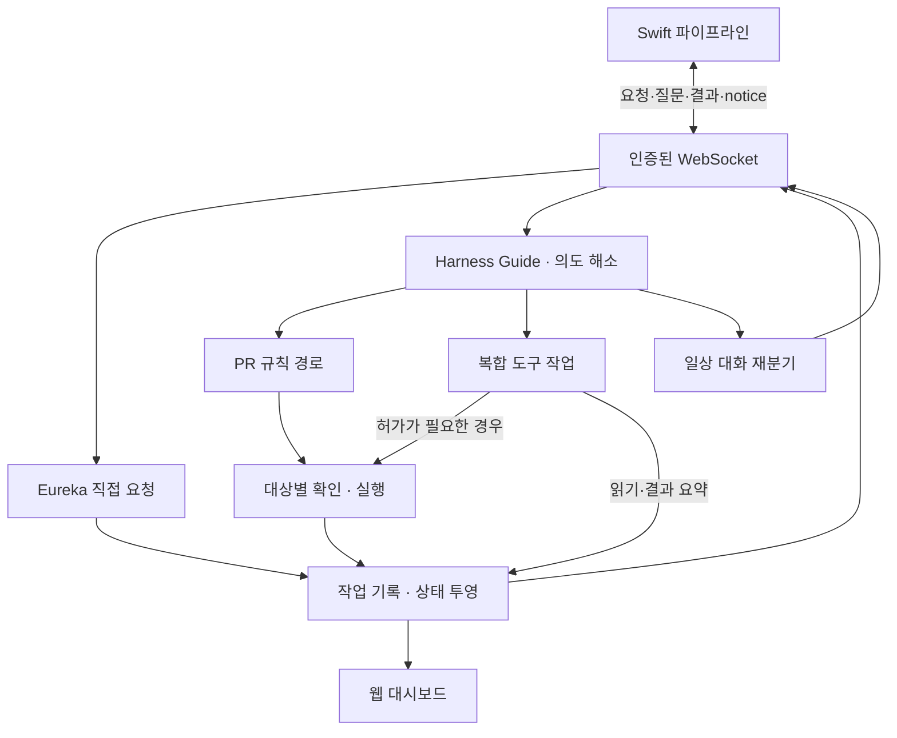

# DeskPet Harness

DeskPet에서 **음성 요청을 외부 업무의 실행과 확인 가능한 결과로 바꾸는 TypeScript 서비스**입니다. Swift 파이프라인은 전사·라우팅·음성 출력을 맡고, Harness는 요청의 대상과 권한을 해석해 Eureka·GitHub 또는 등록된 도구에 연결합니다. 업무 상태, 확인 질문, 실제 실행 결과는 WebSocket으로 파이프라인과 웹 대시보드에 전달합니다.

## 하나의 요청이 처리되는 방식



| 요청 | 처리와 결과 |
| --- | --- |
| **Eureka 조회·변경** | `eureka.*` 요청을 Eureka 경계에서 해석합니다. 업무·단계·체크포인트와 필수 값을 검증하고, 조회·변경 결과를 공통 구조로 돌려줍니다. |
| **GitHub PR 검토** | 대상 PR과 현재 커밋을 확인하고 변경 범위와 검토 상태를 읽습니다. Guide가 승인 의도로 해석하면 전용 확인·실행 경로에 연결합니다. |
| **복합 도구 작업** | LLM으로 업무를 해석하고 `SwarmCoordinator`와 `SwarmWorker`가 Guide에 정의된 도구 범위 안에서 작업을 진행할 수 있습니다. 허가가 요구되는 도구는 `PipelinePermissionQueue`에서 사용자 확인을 기다립니다. |
| **불명확한 발화** | 현재 발화와 대화 맥락 등을 검토해 어떤 처리를 이어갈지 결정합니다. 정보가 부족하면 필요한 내용을 묻습니다. 해석 결과에 따라 Eureka 직접 처리, 복합 도구 작업, 로컬 대화 재분기로 각각 넘깁니다. |

Guide는 실행할 단계와 필요한 질문을 정하고, Gateway는 외부 시스템과 통신합니다. Gemini 또는 OpenAI는 설정에 따라 의도 해석·도구 작업·응답 표현을 보조합니다. 실행 결과와 화면에 표시할 상태는 Gateway 근거와 작업 기록에서 가져옵니다. [LLM 연동](docs/llm-integration.md) · [파이프라인 브리지](docs/pipeline-bridge.md)

## 확인, 실행과 복구

1. **확인 범위를 고정합니다.** PR 승인처럼 확인이 필요한 작업은 요청, 대상, 변경 범위를 연결한 pending 질문을 만듭니다. 사용자에게 실제로 전달한 문구가 `question_delivered`로 보고된 뒤에 후속 답변을 확인과 연결합니다.
2. **실행 직전 상태를 다시 확인합니다.** PR 상태와 head SHA 등 필요한 조건을 점검하고, 기존 확인의 범위를 벗어나면 실행을 보류합니다. GitHub 승인과 연결된 Eureka 단계 반영은 별도 작업과 결과로 다루며, 후속 반영에 필요한 경우 새로 확인합니다.
3. **부작용이 있는 요청의 실행 여부를 기록합니다.** 쓰기 실행 전에 SQLite 저널과 작업 ID를 이용해 중복 제출을 제어합니다. 응답이 사라지면 결과를 `unknown`으로 기록하고 읽기 조회로 실제 상태를 확인합니다. 음성 출력에 실패하더라도 저장된 업무 결과는 유지됩니다.

WebSocket의 `messageId` 재전달 처리와 업무 `operationId` 기록은 서로 다른 경계입니다. 파이프라인 연결은 요청·응답과 지연 결과 notice를 받을 수 있고, 대시보드는 초기 snapshot과 상태 변경을 구독합니다. 서버 재시작으로 epoch가 바뀌면 다시 동기화하고, 항목은 revision을 비교해 갱신합니다. [WebSocket 규약](docs/ws-protocol.md) · [영속 저장소](docs/persistent-store.md)

## 웹 대시보드

- **작업**에서 현재 업무와 단계, 마감 알림, 확인 대기와 실행 결과를 봅니다.
- **기록**에서 세션별 발화와 라우팅 결과, 전달된 응답과 오류를 검색합니다.
- **Guide**에서 공통·도구별 규칙과 기본 지침을 확인하고 편집합니다.
- **설정**에서 연결과 표시 옵션을 조정합니다. 작업 실행 요청은 파이프라인 역할 연결로 받습니다.

보기 전용 접속은 실행용 토큰과 별도로 구성할 수 있습니다. 실제 서비스에 연결할 때는 노출할 주소와 토큰을 환경에 맞춰 설정합니다. [웹 UI](docs/web-ui.md) · [네트워크 접속 설정](docs/remote-access.md)

## 모의 데이터로 시작

Node.js 22.13 이상과 pnpm 10을 사용합니다. 아래 절차는 가짜 GitHub·Eureka로 확인 대기, 성공, 실패, 결과 불명 상태를 재현합니다.

```sh
pnpm install --frozen-lockfile
pnpm web:fixture
```

다른 터미널에서 `pnpm web:dev`를 실행해 [로컬 대시보드](http://127.0.0.1:5173)를 엽니다. 연결 주소는 `ws://127.0.0.1:8788`, 모의 보기 전용 토큰은 `fixture-viewer-token-123`입니다. 파이프라인 형식의 조회는 `pnpm demo:adapter --fixture reminders`로 시험합니다.

## 실제 서비스와 개발

`.env.example`을 `.env`로 복사해 `HARNESS_WS_TOKEN`, `GITHUB_TOKEN`, 사용하려는 서비스의 인증값, LLM 공급자 등을 설정합니다. 쓰기 모드에는 `DESKPET_STORE_PATH`로 지정한 SQLite 저장소가 필요합니다. [환경 변수 예제](.env.example)

```sh
pnpm start --read-only
```

위 명령은 변경 요청을 비활성화한 Harness와 빌드된 대시보드를 기본 `127.0.0.1:8787`에서 제공합니다. `pnpm harness`는 서버를 직접 실행합니다. Swift 연결의 hello, Envelope, 답변·notice 형식은 [파이프라인 연결 안내](docs/pipeline-handoff.md)에 있습니다.

| 소스 | 책임 |
| --- | --- |
| [packages/contracts](packages/contracts) · [packages/server](packages/server) | 메시지 스키마, WebSocket·HTTP, 파이프라인 변환 |
| [packages/harness](packages/harness) · [packages/gateways](packages/gateways) | Guide, 작업 상태·영속화, Eureka·GitHub 연결 |
| [packages/output](packages/output) · [packages/projector](packages/projector) | 출력 문구 검증, 업무 상태 투영 |
| [apps/web](apps/web) · [tests/e2e](tests/e2e) | 대시보드, 확인·중복·복구·연결 시나리오 |

`pnpm check`로 타입 검사, 린트와 테스트를 실행합니다.
